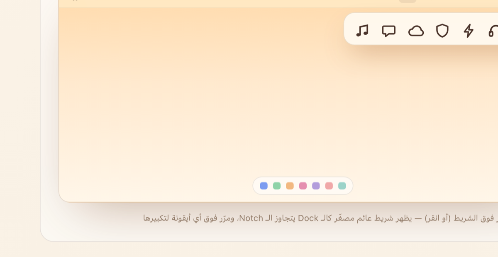

<div align="center">



# HoverBar

**A clean menu bar. Just hover.**

[](.github/workflows/ci.yml)
[](LICENSE)
[](#)

</div>

---

## What is HoverBar?

Your macOS menu bar fills up until icons overflow — especially on MacBooks with a notch.
Existing tools (Bartender, Ice, Hidden Bar) stretch the hidden icons back **into** the bar,
where space is scarce and the notch gets in the way.

HoverBar takes a different approach:

- **Hover the menu bar** → a tiny floating **mini-dock tray** appears right below it,
  showing *all* your hidden icons with real dock-style magnification.
- **Move away** → it glides out and your menu bar stays clean.
- The tray is our own window — it is **notch-proof** and never limited by menu bar width.

> The image above is an interactive HTML mockup (`design-mockups.html`) rendered in the
> approved **Sunrise** theme. It is a concept, not a screenshot of the app (yet!).

## Status

🚧 **Early development — Phase 0 (project scaffolding).** See [`PLAN.md`](PLAN.md) for the full roadmap.

| Phase | Scope | Status |
|---|---|---|
| 0 | Repo, CI, scaffold | 🚧 In progress |
| 1 | MVP: scan + hide + tray with snapshots | ⬜ |
| 2 | Animation & notch/multi-display polish | ⬜ |
| 3 | Settings & onboarding | ⬜ |
| 4 | Robustness | ⬜ |
| 5 | v1.0 release | ⬜ |

## Requirements

- macOS 14 (Sonoma) or later
- Accessibility permission (granted during onboarding)

## Development

```bash
brew install xcodegen     # once
xcodegen generate         # regenerates HoverBar.xcodeproj from project.yml
open HoverBar.xcodeproj   # build & run the HoverBar scheme
```

CI runs `swiftlint --strict` + `xcodebuild build test` on every push.

## Credits & acknowledgements

- [Ice](https://github.com/jordanbaird/Ice) (MIT) — the primary technical reference for
  menu bar item discovery and manipulation via the Accessibility API.
- [Hidden Bar](https://github.com/dwarvesf/hidden) (MIT) — simple AX principles.

## License

[MIT](LICENSE) © 2026 Hawazen Sameer

---

## بالعربية — HoverBar

**شريط قوائم نظيف. فقط مرّر المؤشر.**

في macOS يزدحم شريط القوائم بأيقونات التطبيقات حتى تختفي بعضها — خاصة على أجهزة
MacBook ذات الشاشة المقصوصة (notch). الحلول الحالية تمدّد الأيقونات المخفية داخل
الشريط نفسه حيث المساحة ضيقة.

**HoverBar** يختلف: عند **تمرير المؤشر فوق الشريط** يظهر أسفله **شريط عائم مصغّر
(Mini-Dock)** يعرض كل الأيقونات المخفية بتكبير تفاعلي مثل الـ Dock تماماً، وعند
مغادرة المؤشر يختفي ويبقى الشريط نظيفاً. الشريط العائم نافذة مستقلة لا يحدّها الـ
notch ولا عرض الشريط.

**الحالة:** مرحلة التأسيس (Phase 0) — الخطة الكاملة في [`PLAN.md`](PLAN.md).

- يتطلب macOS 14 أو أحدث، وصلاحية Accessibility فقط
- الترخيص: MIT
- الإسناد: مشروع [Ice](https://github.com/jordanbaird/Ice) مرجعنا التقني الأساسي
